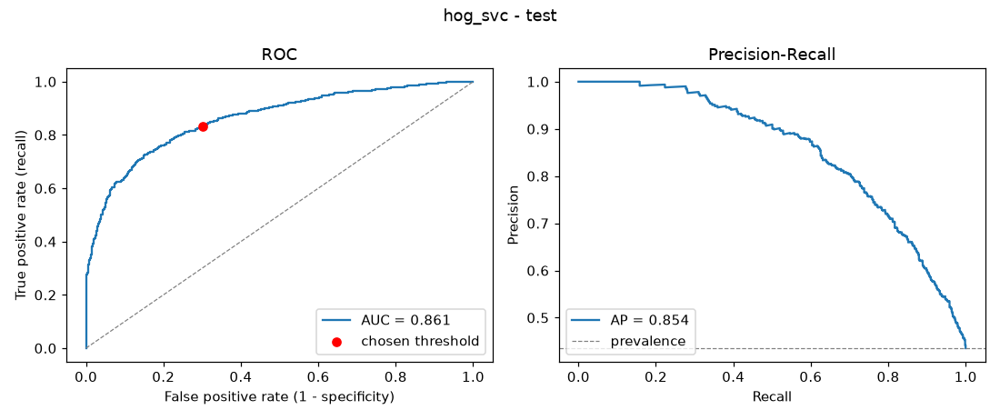

# Medical Vision ML

Classical machine learning on medical data: a recall-first binary classifier for knee X-rays (healthy vs.
osteoarthritis) and an adaptive clustering pipeline for free-text patient testimonies. The core is deliberately
lightweight: it runs on a CPU in minutes, every feature is interpretable (a HOG descriptor written in NumPy, TF-IDF
terms), and it depends only on NumPy, pandas, Matplotlib, scikit-learn, Pillow and JupyterLab. A separate experiment
measures what deep embeddings (frozen ImageNet CNNs, sentence transformers) would add, with the same protocol.

## Results highlights

**Knee osteoarthritis** (KL 0-1 vs. KL 2-4, full run of `configs/full.json` on 2026-11-11, test set of 1,656 images used
once, from [`results/knee/metrics.json`](results/knee/metrics.json)):

| Metric (test, HOG + SVC, RBF, C=10) | Value |
| --- | --- |
| Recall (sensitivity) | **0.831** |
| Specificity | 0.700 |
| Precision | 0.681 |
| F2 | 0.796 |
| ROC-AUC / PR-AUC | **0.861** / 0.854 |
| Balanced accuracy | 0.765 |
| Confusion matrix | TN 654 · FP 281 · FN 122 · TP 599 |

Candidates on validation (threshold set for recall 0.85, so specificity is the comparable number):

| Candidate | CV ROC-AUC | Val ROC-AUC | Val specificity | Search time |
| --- | --- | --- | --- | --- |
| HOG + SVC | 0.861 | **0.861** | **0.674** | 623 s |
| HOG + LogReg | 0.854 | 0.857 | 0.645 | 19 s |
| HOG + RandomForest | 0.822 | 0.838 | 0.634 | 409 s |
| HOG + PCA + HistGradientBoosting | 0.802 | 0.809 | 0.534 | 759 s |
| raw pixels + PCA + SVC | 0.780 | 0.792 | 0.551 | 70 s |
| raw pixels + PCA + LogReg | 0.786 | 0.779 | 0.482 | 132 s |

The hand-written HOG descriptor is the main gain (+0.07 ROC-AUC over raw pixels for the same model family). HOG +
LogReg comes within 0.004 ROC-AUC of the SVC for 30 times less search time. Test recall (0.831) lands slightly below
the 0.85 validation target: a threshold does not transfer perfectly. This is a baseline, **not a diagnostic tool**.



**Testimony clustering** (994 testimonies after cleaning): K-Means chosen automatically with **k = 18, cosine
silhouette 0.125**, noise 0%. HDBSCAN reached 0.161 but left 77% of the texts as noise, so it was rejected. Themes
include `itchy, rash, new, hives, raised`; `wrist, elbow, forearm, hand, palm`; `chest, tightness, tight, pressure`.

**Classical vs. deep embeddings** ([details](experiments/deep_embeddings/README.md)): a frozen ResNet-50 + LogReg
reaches test ROC-AUC 0.835, recall 0.813, specificity 0.665, **below** HOG + SVC. Sentence embeddings (MiniLM) give
3 to 4 broad themes instead of 18.

## Repository layout

```
.
├── README.md
├── requirements.txt            # core: numpy, pandas, matplotlib, scikit-learn, pillow, jupyterlab
├── requirements-deep.txt       # optional: torch, torchvision, sentence-transformers
├── configs/                    # quick.json (smoke test), full.json (reference run)
├── src/
│   ├── kneeclf/                # knee X-ray pipeline: loading, HOG, candidates, threshold, evaluation, CLI
│   └── textclust/              # adaptive CSV-of-texts clustering: loading, cleaning, TF-IDF/SVD, model choice, CLI
├── notebooks/
│   ├── 01_knee_classification.ipynb
│   └── 02_testimony_clustering.ipynb
├── experiments/deep_embeddings/  # frozen CNN and sentence-embedding comparison (needs requirements-deep.txt)
├── results/
│   ├── knee/                   # metrics, comparison, figures of the full knee run
│   └── deep_embeddings/        # knee/ and text/ results of the comparison
├── tests/                      # unittest suites (synthetic images, generated CSV files)
├── data/                       # local data, git-ignored; see data/README.md
└── docs/                       # model card, data cards, performance, retrospective
```

## Quick start

Requires Python 3.9 or newer and scikit-learn 1.3 or newer (for `HDBSCAN`).

```bash
python3 -m venv venv
source venv/bin/activate
pip install -r requirements.txt

# put the data in place (see data/README.md): data/knee/{train,val,test}/{0..4}/*.png and data/testimonies.csv

python -m unittest discover -s tests -v

# testimony clustering (any CSV of texts works)
PYTHONPATH=src python -m textclust data/testimonies.csv --output runs

# knee classifier: smoke test (about 15 s, numbers are not results), then the full run (about 36 min on 4 workers)
PYTHONPATH=src python -m kneeclf --data data/knee --config configs/quick.json
PYTHONPATH=src python -m kneeclf --data data/knee --config configs/full.json --n-jobs 4

jupyter lab notebooks/
```

Each run writes `runs/<timestamp>/` (git-ignored): `metrics.json` (config, data profile, environment, every score,
timings), plots, and for the knee pipeline `comparison.csv`/`.md`, `params.json`, `train.log` and `model.pkl`. The knee
notebook reads the data from `data/knee/`, or from the folder named by the `KNEE_DATA_ROOT` environment variable; its
full-run section only needs `results/knee/`.

`textclust` adapts to any CSV of texts: encoding, delimiter, header, ragged rows, text and label columns, language
(English or French stop words), TF-IDF and SVD sizes, the range of k and the algorithm are detected. Override with
`--text-column`, `--label-column`, `--no-labels`, `--k`, `--language`, or a `Config` object in Python.

Memory: the full knee run at 112 px holds about 0.37 GB of pixels plus 0.18 GB of HOG features, a few GB at peak with
four workers. At 224 px (`"image_size": null`) plan for 16 GB of RAM.

## Data

No dataset is stored in this repository. See [`data/README.md`](data/README.md) for where to put the files.

- **Knee X-rays**: Kaggle [Knee Osteoarthritis Dataset with Severity Grading](https://www.kaggle.com/datasets/shashwatwork/knee-osteoarthritis-dataset-with-severity)
  (CC BY 4.0), 224x224 grayscale PNGs, one folder per Kellgren-Lawrence grade. [Data card](docs/data-cards/knee-xrays.md).
- **Patient testimonies**: the CSV is not in the repository (it is git-ignored) because we have neither its license nor
  permission to redistribute it. [Data card](docs/data-cards/patient-testimonies.md). Any other CSV of texts works with
  the same pipeline.

## Documentation

| Document | Content |
| --- | --- |
| [Model card](docs/model-card.md) | Knee classifier: intended use, data, metrics, threshold, limitations, reproduction |
| [Data card: knee X-rays](docs/data-cards/knee-xrays.md) | Source, license, KL counts, preprocessing, known issues |
| [Data card: patient testimonies](docs/data-cards/patient-testimonies.md) | Availability, privacy, counts, known issues |
| [Performance](docs/performance/README.md) | Run environment, durations per candidate, memory, clustering run time |
| [Retrospective](docs/retrospective/README.md) | Project history, what worked, what we would change, alternatives |

## Classical vs. deep embeddings

The core uses classical features on purpose: it runs on any laptop CPU, its features can be inspected, and its
dependency set stays small. [`experiments/deep_embeddings/`](experiments/deep_embeddings/README.md) checks what that
choice costs. It imports the core (same data loading, label scheme, threshold protocol and model selection) and the core
never imports from it; its dependencies are in `requirements-deep.txt`.

| Task | Classical core | Deep embeddings |
| --- | --- | --- |
| Knee X-rays (test) | HOG + SVC: ROC-AUC **0.861**, recall 0.831, specificity 0.700 | frozen ResNet-50 + LogReg: ROC-AUC 0.835, recall 0.813, specificity 0.665 |
| Testimonies | TF-IDF + SVD: k = 18, silhouette 0.125 | all-MiniLM-L6-v2: k = 4, silhouette 0.169; multilingual MiniLM-L12: k = 3, silhouette 0.193 (own spaces, not comparable); ARI vs. core 0.14 to 0.24 |

Frozen natural-image features did not beat HOG; fine-tuning was not run because it needs a GPU. Sentence embeddings
produce coarser themes for an 87 to 449 MB model download.

## Author

[Ridwane777](https://github.com/Ridwane777)
